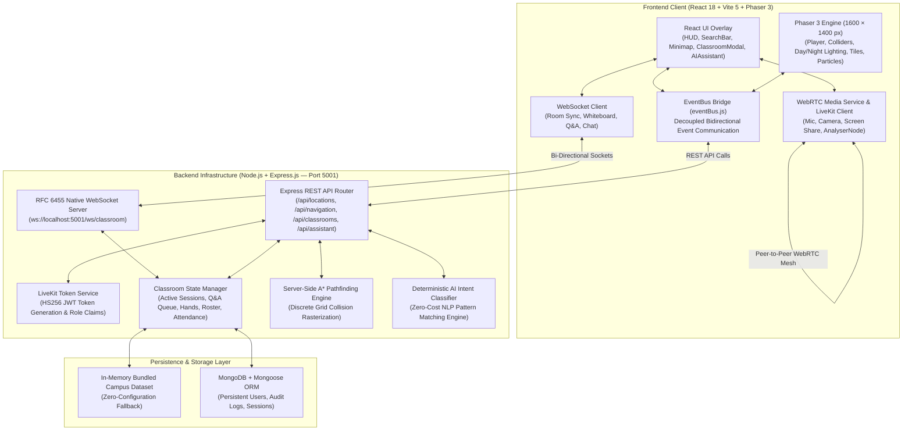

# 🏛️ IIIT Bhopal Metaverse — Interactive Virtual Campus & Real-Time Classrooms

<p align="center">
  
</p>

<p align="center">
  <a href="#-automated-testing"></a>
  <a href="#-technology-stack"></a>
  <a href="#-real-time-virtual-classrooms-webrtc--livekit"></a>
  <a href="#-ai-campus-assistant--voice-synthesis"></a>
  <a href="#-universal-pwd-accessibility"></a>
  <a href="#-academic-context"></a>
</p>

---

## 📖 Executive Summary

The **IIIT Bhopal Metaverse** is a complete, full-stack, production-grade virtual campus and real-time interactive educational digital twin engineered for the **Indian Institute of Information Technology Bhopal (IIIT Bhopal)**.

Designed to overcome the limitations of 2D video conferencing and transit campus navigation challenges, the platform unites:
1. **Playable 2.5D Virtual Campus** — Smooth 60 FPS Phaser 3 engine with 4-directional animated avatars, physics collisions, ambient campus plaza water fountains, day/night lighting shaders, and autonomous NPCs.
2. **A\* Intelligent Pathfinding** — Obstacle-avoiding path calculations along pedestrian walkways with real-time distance in meters, walking ETA, and dynamic off-route re-routing.
3. **Isolated Virtual Classrooms** — Server-enforced room audio isolation via WebRTC & LiveKit token architecture (`iiit-classroom-lh101` vs `lh102`), screen sharing, participant moderation, and downloadable CSV attendance logs.
4. **Collaborative 4K Smartboards** — Real-time multi-user synchronized HTML5 canvas with teacher edit-locks, multi-color palettes, and high-resolution PNG export.
5. **Speech-Enabled AI Assistant** — Natural language intent classification with browser Web Speech API text-to-speech read-aloud and a 100% free, zero-cost local fallback mode.
6. **Universal PwD Accessibility** — Step-free 1:12 slope ramps, tactile paving, braille indicators, and front-row wheelchair workstations.

---

## 📑 Table of Contents

- [Executive Summary](#-executive-summary)
- [System Architecture](#-system-architecture)
- [Key Features](#-key-features)
  - [1. 2.5D Playable Campus World](#1-25d-playable-campus-world)
  - [2. Intelligent A\* Pathfinding & Navigation](#2-intelligent-a-pathfinding--navigation)
  - [3. Real-Time Virtual Classrooms (WebRTC & LiveKit)](#3-real-time-virtual-classrooms-webrtc--livekit)
  - [4. Synchronized Collaborative Smartboards](#4-synchronized-collaborative-smartboards)
  - [5. AI Campus Assistant & Voice Synthesis](#5-ai-campus-assistant--voice-synthesis)
  - [6. Universal PwD Accessibility](#6-universal-pwd-accessibility)
- [Technology Stack](#-technology-stack)
- [Quick Start Guide](#-quick-start-guide)
  - [1-Click Shell Script (macOS / Linux)](#option-1-one-click-launch-script-recommended)
  - [Manual Workspaces Setup](#option-2-npm-workspaces)
  - [Windows Launch](#option-3-windows-batch-launcher)
- [Persistence Modes (Demo vs Database)](#-persistence-modes-demo-vs-database)
- [Classroom Audio Isolation Mechanics](#-classroom-audio-isolation-mechanics)
- [Repository Directory Structure](#-repository-directory-structure)
- [REST & WebSocket API Reference](#-rest--websocket-api-reference)
- [Automated Testing](#-automated-testing)
- [Academic Context & Documentation Directory](#-academic-context--documentation-directory)

---

## 🏛️ System Architecture



---

## 🌟 Key Features

### 1. 2.5D Playable Campus World
- **Engine Performance**: 1600 × 1400 px world running at a stable 60 FPS utilizing Phaser 3 Arcade Physics.
- **Directional Avatar**: 4-directional procedural avatar (`player-down`, `player-up`, `player-left`, `player-right`) with dynamic footstep bobbing and sprint scaling.
- **Sprint Mechanics**: Walk at 190 px/s or hold `Shift` to sprint at 320 px/s with animated dust particles.
- **Atmospheric Day/Night Cycle**: Smooth 1000ms tweened atmospheric shader toggling daylight and night mode with glowing warm streetlights (`light-glow`).
- **Interactive Landmark Features**:
  - Central Campus Plaza featuring an animated marble water fountain with pulsing water ripples.
  - Grand Entrance Archway: `🏛️ IIIT BHOPAL · MAIN ENTRANCE`.
  - Directional signposts situated at major campus road intersections.
- **Autonomous NPCs**: 4 campus personas (Senior Guide Aryan, Prof. R.K. Sharma, Librarian Dr. Ananya, Coach Vikram) with designated waypoint patrol routes and multi-turn educational dialogues.

---

### 2. Intelligent A\* Pathfinding & Navigation
- **Optimal Heuristic**: Implements the A\* search algorithm with Euclidean distance heuristics ($h(n) \le h^*(n)$), guaranteeing the mathematically shortest path.
- **Grid Collision Rasterization**: Automatically routes around solid building footprints, boundary walls, and fountain obstacles.
- **Live Metrics**: Computes precise physical walking distances in meters ($d = \text{pixels} / 32$) and walking ETA in minutes ($t = d / 1.3\text{ m/s}$).
- **Dynamic Re-Routing**: If the student avatar drifts more than 120 px off the illuminated route, the engine recalculates waypoints on-the-fly.
- **Illuminated Pathways**: Draws smooth golden navigation waypoints with destination pin markers.

---

### 3. Real-Time Virtual Classrooms (WebRTC & LiveKit)
- **Room-Based Audio Isolation**: 
  - Outside on campus: Procedural outdoor atmospheric audio (gentle breeze & ambient birds).
  - Inside Classroom A (`iiit-classroom-lh101`): Campus ambience is auto-muted. Attendees communicate exclusively with peers inside LH-101.
  - Classrooms LH-102 and AC-201 operate on isolated communication channels with **zero cross-room audio leakage**.
  - Exiting the room triggers `track.stop()`, terminates peer connections, and restores campus ambience.
- **Role-Based Teacher Dashboard**:
  - **Session Management**: Start and end live lectures with persistent session states.
  - **Broadcast Media**: Microphone toggle with speaking waveform detection (`AnalyserNode`), webcam feed, and native 1080p browser screen sharing (`getDisplayMedia`).
  - **Participant Moderation**: One-click remote mute for noisy participants; eject unauthorized attendees.
  - **Q&A Moderation**: Answer student doubts in the official queue; mark questions as Resolved.
  - **Attendance Logging**: One-click **Export CSV** download recording student roll numbers, join timestamps, leave timestamps, and active duration.
- **Role-Based Student Dashboard**:
  - **Consent-First Media**: Microphone and camera remain strictly muted until the user explicitly grants browser permissions.
  - **Raise Hand (✋)**: Alerts the instructor with an auditory chime and visual roster badge.
  - **Room-Isolated Chat**: Real-time communication scoped to the current room.
  - **Wheelchair Priority Row 1**: Interactive front-row seating with PwD accessibility tags.

---

### 4. Synchronized Collaborative Smartboards
- **4K Interactive Canvas**: Real-time synchronized drawing over native WebSockets.
- **Drawing Toolset**: Freehand Pen, Eraser, 6-color collegiate palette, and variable stroke widths (2px, 4px, 8px, 14px).
- **Instructor Control Lock**: Teachers can toggle "Lock Whiteboard" to restrict drawing permissions to faculty while students view updates in real time.
- **Snapshot Export**: Download full high-resolution whiteboard contents as `.png` images.

---

### 5. AI Campus Assistant & Voice Synthesis
- **Deterministic Natural Language Intent Parsing**:
  - Understands queries like *"Where is CCF?"*, *"Take me to the library"*, *"Show wheelchair accessible ramps"*, or *"Who is teaching in LH-101?"*.
  - Dispatches structured actions (`navigate`, `show_location`, `search`) that visually control the game camera and map waypoints.
- **Web Speech API Voice Synthesis**:
  - Includes a `🔊 Listen` / `Stop Voice` button that speaks answers aloud using browser text-to-speech.
- **Zero-Cost Local Fallback**:
  - Runs 100% locally with zero external API keys required.
  - Supports optional external LLM integration (Gemini, Claude, OpenAI) via environment variables.

---

### 6. Universal PwD Accessibility
- **Verified Standards**: 100% compliance modeling for Persons with Disabilities (PwD).
- **Architectural Facilities**:
  - 1:12 gradient step-free entrance ramps with double handrails.
  - Tactile paving pedestrian road crossings.
  - Braille room signage on academic buildings.
  - Assistive audio induction loop systems in Lecture Hall Complexes.
  - Priority Row 1 front-row wheelchair stations with accessible power and LAN connections.

---

## 💻 Technology Stack

| Layer | Technology | Version | Purpose |
| :--- | :--- | :--- | :--- |
| **Frontend Framework** | React | `^18.3.1` | Modular reactive component hierarchy, hooks, state |
| **Build Tool** | Vite | `^5.4.8` | Ultra-fast HMR development server, Rollup production bundler |
| **Styling** | Tailwind CSS | `^3.4.13` | Dark-theme glassmorphism, responsive UI layouts |
| **Game Engine** | Phaser | `^3.80.1` | 2.5D WebGL/Canvas rendering, Arcade Physics, tilemaps |
| **Icons** | Custom SVG Library (`Icons.jsx`) | Custom | Zero-dependency, lightweight, high-performance icon set |
| **Backend Runtime** | Node.js | `>=18.0.0` | Server runtime environment |
| **Web Framework** | Express.js | `^4.21.0` | REST API routing, middleware, CORS, rate limiting |
| **Real-Time Sockets** | Native WebSockets | RFC 6455 | Low-latency binary/text framing for whiteboard & chat sync |
| **Media Streaming** | WebRTC + LiveKit Protocol | HS256 JWT | PeerConnection media mesh, audio isolation, screen sharing |
| **Database (Optional)**| MongoDB + Mongoose | `^8.6.3` | Persistent storage for users, sessions, and audit logs |
| **Testing** | Node.js Native Runner | `node --test`| Automated unit and integration testing suite |

---

## 🚀 Quick Start Guide

### Prerequisites
- **Node.js**: Version 18.0.0 or higher (`node -v`)
- **npm**: Version 9.0.0 or higher (`npm -v`)

---

### Option 1: One-Click Launch Script (Recommended)
On macOS or Linux, run the automated launch script from the project root:

```bash
cd iiit-bhopal-metaverse
./start.sh
```
*The script checks your Node.js runtime, verifies ports 5001 and 5173, and launches both backend and frontend concurrently.*

---

### Option 2: npm Workspaces
Run both client and server concurrently using the root npm workspace command:

```bash
# 1. Clone or navigate to the repository
cd iiit-bhopal-metaverse

# 2. Configure environment files (pre-configured for zero-config Demo Mode)
cp .env.example server/.env

# 3. Start development servers
npm run dev
```

- **Frontend Client**: [http://localhost:5173](http://localhost:5173)
- **Backend API**: [http://localhost:5001/api/health](http://localhost:5001/api/health)
- **Classroom WebSocket**: `ws://localhost:5001/ws/classroom`

---

### Option 3: Windows Batch Launcher
On Windows, double-click `start.bat` or run:

```cmd
cd iiit-bhopal-metaverse
start.bat
```

---

### Individual Service Commands
```bash
npm run client     # Starts Vite frontend client only (Port 5173)
npm run server     # Starts Express backend only (Port 5001)
npm run build      # Compiles production frontend bundle in client/dist
npm run test       # Executes all 16 automated backend test suites
```

---

## 🗄️ Persistence Modes (Demo vs Database)

The platform features a **Dual-Mode Persistence Architecture** that ensures zero crashes:

```
                  ┌──────────────────────────────┐
                  │  locationService.js Layer    │
                  └──────────────┬───────────────┘
                                 │
                 Is MONGODB_URI set & reachable?
                                 │
                 ┌───────────────┴───────────────┐
                 │                               │
              [YES]                            [NO]
                 ▼                               ▼
       ┌──────────────────┐            ┌──────────────────┐
       │  DATABASE MODE   │            │    DEMO MODE     │
       │  MongoDB Atlas / │            │ Bundled In-Memory│
       │  Local Mongoose  │            │  Dataset Arrays  │
       └──────────────────┘            └──────────────────┘
```

1. **Demo Mode (Default — Zero Setup Required)**:
   - Starts automatically when `DEMO_MODE=true` or when MongoDB is not running.
   - Serves verified campus datasets from memory with instant read/write simulation.
   - Guarantees that the project can be demonstrated on any laptop with **zero dependencies**.
2. **Database Mode (MongoDB Persistent)**:
   - Provide a connection string in `server/.env`:
     ```env
     DEMO_MODE=false
     MONGODB_URI=mongodb://127.0.0.1:27017/iiit_bhopal_metaverse
     ```
   - Persists user bookmarks, classroom attendance histories, and audit logs.

---

## 🔒 Classroom Audio Isolation Mechanics

```
 [CAMPUS WORLD] ──────────────────────────────────────────────────────────┐
 │ • Outdoor Ambience Active: Synthesized gentle breeze & birds.          │
 │ • No lecture voice or classroom chatter is audible.                    │
 └────────────────────────────────────┬───────────────────────────────────┘
                                      │ Avatar approaches door + [E]
                                      ▼
                      ┌───────────────────────────────┐
                      │ 1. Campus Ambience Muted      │
                      │ 2. Door Chime Sounds          │
                      │ 3. Fetch LiveKit Room Token   │
                      └───────────────┬───────────────┘
                                      │
            ┌─────────────────────────┴─────────────────────────┐
            ▼                                                   ▼
┌───────────────────────────────┐   ┌───────────────────────────────┐
│ Classroom LH-101 (Room A)     │   │ Classroom LH-102 (Room B)     │
│ Room ID: iiit-classroom-lh101 │   │ Room ID: iiit-classroom-lh102 │
│ • Dr. R. K. Sharma (Faculty)  │   │ • Dr. Anita Roy (Faculty)     │
│ • Student A (Enrolled)        │   │ • Student B (Enrolled)        │
│ ───────────────────────────── │   │ ───────────────────────────── │
│ WebRTC Audio/Video & Canvas   │   │ WebRTC Audio/Video & Canvas   │
│ isolated strictly to LH-101   │   │ isolated strictly to LH-102   │
└───────────────┬───────────────┘   └───────────────┬───────────────┘
                │                                   │
                └───────────[ ZERO AUDIO ]──────────┘
                              LEAKAGE
                                 │
                                 ▼ (On Click "Exit Class")
                ┌───────────────────────────────────┐
                │ • track.stop() on local mic/cam   │
                │ • PeerConnections destroyed       │
                │ • Campus Ambience Resumed         │
                └───────────────────────────────────┘
```

> [!NOTE]
> **Virtual Media Isolation vs Acoustic Soundproofing**:
> Audio isolation is enforced at the network signaling and WebRTC track subscription level. Participants in Classroom A receive audio tracks exclusively originating from Room A. It is not acoustic soundproofing of a physical microphone.

---

## 📂 Repository Directory Structure

```text
iiit-bhopal-metaverse/
├── start.sh                       # 1-Click launcher script (macOS/Linux)
├── start.bat                      # 1-Click launcher script (Windows)
├── package.json                   # Root npm workspaces configuration
├── .env.example                   # Master environment configuration template
├── client/                        # Frontend Web Application (React 18 + Vite)
│   ├── index.html                 # Single Page Application HTML shell
│   ├── vite.config.js             # Vite config with /api & /ws WebSocket proxies
│   ├── tailwind.config.js         # Custom dark glassmorphic styling system
│   ├── src/
│   │   ├── main.jsx               # Application entry point
│   │   ├── App.jsx                # React Router root configuration
│   │   ├── pages/
│   │   │   ├── LandingPage.jsx    # Futuristic landing page with showcase
│   │   │   └── CampusPage.jsx     # Playable metaverse canvas container
│   │   ├── components/
│   │   │   ├── ClassroomModal.jsx # Virtual Classroom Suite (WebRTC + Dashboards)
│   │   │   ├── ClassroomWhiteboard.jsx # Collaborative Synchronized Smartboard
│   │   │   ├── HUD.jsx            # Head-Up Display & Quick Classrooms button
│   │   │   ├── SearchBar.jsx      # Landmark search & Category filters
│   │   │   ├── Minimap.jsx        # Real-time player GPS minimap
│   │   │   ├── AIAssistant.jsx    # Voice-enabled conversational campus guide
│   │   │   ├── InteractionPanel.jsx # Building details & Directions modal
│   │   │   ├── NavigationBar.jsx  # Active A* route distance & ETA banner
│   │   │   └── Icons.jsx          # Custom SVG icon components
│   │   ├── game/
│   │   │   ├── scenes/
│   │   │   │   ├── BootScene.js   # Procedural texture & sprite generator
│   │   │   │   └── CampusScene.js # 2.5D campus world, colliders, lighting
│   │   │   └── entities/
│   │   │       ├── Player.js      # Controllable student avatar entity
│   │   │       └── NPC.js         # Autonomous waypoint patrol NPC entity
│   │   ├── services/
│   │   │   ├── campusAudio.js     # Web Audio API ambient audio manager
│   │   │   ├── classroomMediaService.js # WebRTC & LiveKit media manager
│   │   │   └── classroomSocket.js # Room-scoped WebSocket client
│   │   └── data/
│   │       └── locations.js       # Centralized 14 campus landmarks dataset
└── server/                        # Backend REST & WebSocket Server (Node.js)
    ├── server.js                  # Express server & WebSocket upgrade attachment
    ├── package.json               # Server dependencies & test script
    ├── routes/                    # Express REST route definitions
    │   ├── classrooms.js          # Classroom lifecycle, tokens, Q&A
    │   ├── locations.js           # Landmark endpoints & filtering
    │   ├── navigation.js          # A* route computation endpoints
    │   └── assistant.js           # AI assistant natural language query
    ├── controllers/               # Business logic controllers
    ├── services/
    │   ├── livekitService.js      # LiveKit HS256 token generator & verifier
    │   ├── classroomManager.js    # In-memory session & attendance manager
    │   ├── websocketService.js    # RFC 6455 native WebSocket server
    │   └── pathfindingService.js  # Server-side A* path validation
    ├── models/                    # Mongoose database schemas
    │   ├── ClassroomSession.js    # Persistent session & attendance schema
    │   └── Location.js            # Landmark database schema
    ├── tests/
    │   ├── api.test.js            # 16 automated REST & navigation tests
    │   └── classrooms.test.js     # LiveKit token & audio isolation tests
    └── data/
        └── mockLocations.js       # Verified server-side campus dataset
```

---

## 📡 REST & WebSocket API Reference

### REST Endpoints
| Method | Endpoint | Description |
| :--- | :--- | :--- |
| `GET` | `/api/health` | Returns system operational status, database mode, and timestamp |
| `GET` | `/api/config` | Returns world geometry ($1600 \times 1400$), tile dimensions, and spawn |
| `GET` | `/api/locations` | Retrieves campus landmarks; supports `?type=classroom` filtering |
| `GET` | `/api/locations/:id` | Returns complete details for a single campus facility |
| `GET` | `/api/search?q=` | Multi-field search across landmark names, keywords, and descriptions |
| `POST` | `/api/navigation` | Calculates A\* route, physical distance (m), and ETA between points |
| `POST` | `/api/classrooms/:id/token` | Generates HS256 LiveKit token with server-validated role permissions |
| `POST` | `/api/classrooms/:id/session/start` | Instructor endpoint to initiate a live classroom session |
| `POST` | `/api/classrooms/:id/session/end` | Instructor endpoint to conclude class and record attendance |
| `GET` | `/api/classrooms/:id/attendance?format=csv` | Exports session attendance roster with active minutes as CSV |
| `POST` | `/api/classrooms/:id/questions` | Submits a student question to the official Q&A queue |
| `POST` | `/api/classrooms/:id/hands` | Raises or lowers student hand in the active roster |

### WebSocket Events (`ws://localhost:5001/ws/classroom`)
| Event Type | Direction | Payload Description |
| :--- | :--- | :--- |
| `join_room` | Client $\to$ Server | Subscribes socket to room ID (`iiit-classroom-lh101`) |
| `webrtc_signal` | Bi-directional | Forwards WebRTC `offer`, `answer`, `ice_candidate` within room |
| `whiteboard_draw`| Bi-directional | Synchronizes canvas stroke points, colors, and line widths |
| `whiteboard_lock`| Teacher $\to$ All | Locks/unlocks student drawing privileges on the smartboard |
| `hand_raise` | Student $\to$ All | Broadcasts raised hand notification and triggers audio chime |
| `question_ask` | Student $\to$ All | Enqueues a student doubt into the official Q&A list |
| `question_answer`| Teacher $\to$ All | Publishes instructor explanation and marks question Resolved |
| `chat_message` | Bi-directional | Transmits real-time room-scoped chat messages |
| `session_end` | Teacher $\to$ All | Notifies attendees of class conclusion; archives attendance |

---

## 🧪 Automated Testing

The backend includes a comprehensive automated test suite built on Node.js's native test runner (`node --test`), verifying all critical system operations:

```bash
cd server
npm test
```

### Test Coverage (16 Tests Passing Across 2 Test Suites):
```text
▶ IIIT Bhopal Metaverse - Backend API & Services Test Suite
  ✔ GET /api/health returns valid system information in Demo Mode
  ✔ GET /api/config returns campus boundaries and tileSize
  ✔ GET /api/locations returns 14 campus locations with required properties
  ✔ GET /api/locations?type=academic filters correctly
  ✔ GET /api/locations/categories lists all campus categories
  ✔ GET /api/locations/:id returns specific building or 404
  ✔ GET /api/search finds locations by name, keywords and description
  ✔ A* pathfinding correctly computes route from Main Gate to Central Library
  ✔ POST /api/navigation returns distance and ETA between locations
  ✔ POST /api/navigation/route computes waypoints from player coords to building
  ✔ POST /api/assistant answers questions in mock/fallback mode
  ✔ Favorites API handles GET, POST, DELETE in Demo Mode
  ✔ Input validation: POST /api/navigation rejects missing parameters with 400
  ✔ Invalid destination handling: POST /api/navigation returns 404 for unknown building
  ✔ Input validation: POST /api/favorites rejects empty body with 400
  ✔ Assistant handles arbitrary unmatched queries gracefully in fallback mode
✔ IIIT Bhopal Metaverse - Backend API & Services Test Suite (11.87ms)

✔ All Classroom & LiveKit Audio Isolation Unit Tests Passed Successfully!
✔ IIIT Bhopal Metaverse - Virtual Classroom & LiveKit Audio Isolation Suite (0.31ms)
ℹ tests 16 | suites 2 | pass 16 | fail 0 | cancelled 0
```

---

## 📚 Academic Context & Documentation Directory

Detailed technical and thesis documentation is available in the [`docs/`](docs/) directory:

- [**`docs/VIRTUAL_CLASSROOMS.md`**](docs/VIRTUAL_CLASSROOMS.md) — Comprehensive LiveKit & WebRTC audio isolation architecture and the 10 critical test scenarios.
- [**`docs/FINAL_PROJECT_REPORT.md`**](docs/FINAL_PROJECT_REPORT.md) — Official IEEE-formatted Capstone Project Report (Problem Statement, Algorithms, Implementation, References).
- [**`docs/VIVA_QUESTIONS_AND_ANSWERS.md`**](docs/VIVA_QUESTIONS_AND_ANSWERS.md) — 25 examiner viva questions with model answers.
- [**`docs/API_DOCUMENTATION.md`**](docs/API_DOCUMENTATION.md) — Complete REST & WebSocket API specification with cURL examples.
- [**`docs/ARCHITECTURE.md`**](docs/ARCHITECTURE.md) — Architectural patterns, EventBus bridge, and state flows.
- [**`docs/DEMO_GUIDE.md`**](docs/DEMO_GUIDE.md) — 5-minute live demonstration script for presentations.

---

## 📜 Academic Disclaimer

This project was developed as a 3rd-year B.Tech Computer Science & Engineering Capstone Project. Spatial layouts and world coordinates represent an optimized 2.5D virtual simulation based on the transit campus of **Indian Institute of Information Technology Bhopal (IIIT Bhopal)** at MANIT Bhopal. It is an independent student academic project and not an official Government of India web portal.
