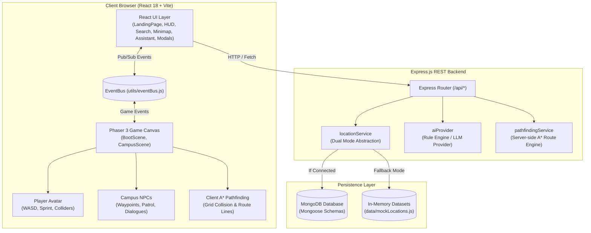

# IIIT Bhopal Metaverse — System Architecture

This document provides a comprehensive technical overview of the software architecture, design patterns, subsystem boundaries, and data flows of the **IIIT Bhopal Metaverse** project.

---

## 1. High-Level Architectural Overview

The IIIT Bhopal Metaverse adopts a **decoupled hybrid architecture** combining a 2.5D game engine (**Phaser 3**) embedded within a modern reactive web application (**React 18 + Vite**), powered by an **Express.js** REST backend with a dual-mode persistence layer (**MongoDB + In-Memory Fallback**).



---

## 2. Frontend Subsystems & EventBus Bridge

### 2.1 The Decoupling Problem
Embedding a canvas-based game engine inside a reactive virtual DOM (React) often creates tight coupling, memory leaks, and unwanted canvas re-initializations during React re-renders.

### 2.2 The Solution: EventBus Bridge
The project decouples React UI from the Phaser game loop using an event-driven pub/sub bus (`client/src/utils/eventBus.js`):
- **Phaser ➔ React**: When the player walks, approaches a building, or reaches a destination:
  - `player:moved` ➔ Updates live location badge, coordinates, and sprint status on the HUD.
  - `location:interact` ➔ Triggers the interactive building panel modal in React.
  - `npc:talk` ➔ Opens the NPC conversation dialogue.
  - `navigate:result` ➔ Updates the distance (m) and ETA (min) on the NavigationBar.
  - `navigate:arrived` ➔ Displays arrival celebration and clears waypoints.
- **React ➔ Phaser**: When the user searches, selects a destination, toggles time, or clicks:
  - `location:focus` ➔ Smoothly pans the Phaser camera to the targeted building.
  - `navigate:request` ➔ Prompts Phaser to calculate and draw an illuminated golden A* pathway.
  - `navigate:cancel` ➔ Erases the active path and destination marker.
  - `timeOfDay:toggle` ➔ Tweens the day/night atmospheric lighting shader.
  - `player:respawn` ➔ Smoothly returns player avatar to the Main Gate.

### 2.3 Component Lifecycle Management
The custom React hook `useGameInstance(parentId)` guarantees:
- Exactly **one** Phaser game instance is instantiated per session.
- Automatic canvas destruction and resource cleanup on route unmount, preventing WebGL / Canvas context leaks.
- Dynamic canvas resize event listener attached to `window.resize`.

---

## 3. Game World & Coordinate System

- **World Dimensions**: 1600 × 1400 world pixels.
- **Grid Resolution**: 32 × 32 px per tile.
  - Grid Columns = 50 tiles.
  - Grid Rows = 43 tiles.
- **Physical Scale**: 1 tile (32px) ≈ 1 real-world meter.
  - Walking speed = 190 px/s (~1.3 m/s, standard human walking pace).
  - Sprinting speed = 320 px/s (~2.2 m/s).
- **Colliders & Layers**:
  - `Depth 0`: Procedural terrain (grass base).
  - `Depth 1-2`: Asphalt road network, lane stripes, and landscaped green zones.
  - `Depth 3-5`: Solid building structures, physics colliders, shadows, and entrance nameplates.
  - `Depth 10`: Illuminated A* golden pathfinding graphics.
  - `Depth 12-14`: Procedural trees, streetlights, and ambient fixtures.
  - `Depth 15`: Player avatar sprite with directional animations.
  - `Depth 16`: Interactive NPCs and floating dialogue badges.
  - `Depth 25`: Day/Night dark blue lighting overlay with smooth alpha transitions.
  - `Depth 26`: Warm radial streetlight glows activated during night mode.

---

## 4. Intelligent Navigation & Pathfinding (A* Algorithm)

### 4.1 Grid Rasterization
Both client and server convert the campus geometry into a 2D occupancy grid:
- Empty tiles / roads / courtyards / grass = `1` (Walkable).
- Building footprints = `0` (Solid Obstacle).
- Open courtyards and amphitheaters = `1` (Passable).

### 4.2 Algorithm Execution
1. **Start & Goal Clamping**: Coordinates are converted to grid cells via `c = floor(x / tileSize)`, `r = floor(y / tileSize)`.
2. **Radial Walkable Search**: If an avatar or destination begins inside an obstacle boundary, `findNearestWalkable()` radially searches concentric neighbors to find the nearest navigable entrance.
3. **A\* Heuristic**: Manhattan distance $h(n) = |r_1 - r_2| + |c_1 - c_2|$ drives the priority queue.
4. **Collinear Path Simplification**: Intermediate redundant straight-line points are pruned using cross-product collinearity checking ($\Delta x_1 \Delta y_2 - \Delta y_1 \Delta x_2 = 0$).
5. **Dynamic Off-Route Recalculation**: If the player wanders more than 120px away from the active route, the path recalculates in real-time.

---

## 5. Backend REST Service & Data Architecture

### 5.1 Service Abstraction Layer (`locationService.js`)
Controllers do not interact directly with Mongoose or local files. Instead, `locationService.js` acts as a unified repository:
- Checks `isDbConnected()`.
- If MongoDB is available and populated, queries collections via Mongoose.
- If MongoDB is offline, transparently serves from `mockLocations.js`.
- Never throws unhandled database errors to client requests.

### 5.2 Provider-Independent AI Architecture
```text
POST /api/assistant
       │
       ▼
assistantController.js
       │
       ▼
aiProvider.js (Factory & Router)
       ├─► mockProvider.js    (Zero-cost regex & keyword intent parser)
       └─► anthropicProvider.js (Optional LLM provider with fallback)
```
- If an upstream provider fails (network timeout, rate limit, missing key), the service automatically cascades down to `mockProvider.js`.
- Frontend never communicates with external AI services directly; API secrets remain securely on the server.

---

## 6. Mongoose Data Schemas

1. **`Location`**:
   - `id`: String (unique slug)
   - `name`: String
   - `type`: Enum (`academic`, `admin`, `research`, `hostel`, `food`, `sports`, `entrance`, `other`)
   - `categoryName`: String
   - `x`, `y`, `width`, `height`: Number
   - `description`: String
   - `services`: [String]
   - `hours`: String
   - `searchable`: Boolean
   - `interactive`: Boolean
   - `keywords`: [String]

2. **`User`**:
   - `name`: String
   - `email`: String (unique)
   - `role`: Enum (`student`, `faculty`, `admin`, `guest`)
   - `avatarConfig`: { `sprite`: String, `savedLocations`: [String] }

3. **`NPC`**:
   - `id`: String
   - `name`: String
   - `role`: String
   - `x`, `y`: Number
   - `dialogue`: [String]
   - `patrol`: [{ `x`: Number, `y`: Number }]

4. **`ChatMessage`**:
   - `userId`: String
   - `message`: String
   - `reply`: String
   - `action`: Object
   - `timestamp`: Date

5. **`NavigationLog`**:
   - `userId`: String
   - `from`: String
   - `to`: String
   - `distanceM`: Number
   - `etaSeconds`: Number
   - `timestamp`: Date
