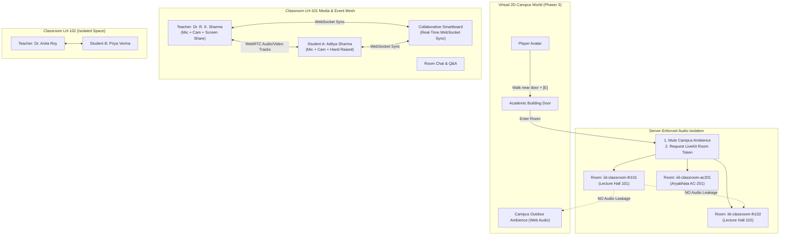

# IIIT Bhopal Metaverse — Real-Time Interactive Virtual Classrooms

## 1. System Architecture Overview

The IIIT Bhopal Metaverse features a full-stack, server-enforced **Interactive Virtual Classroom System** with real-time audio/video communication, collaborative smartboards, Q&A queuing, hand-raising, and room-level audio isolation.



---

## 2. Audio & Media Isolation Specification

### Expected Behaviour
- **Outside any classroom (on campus):**
  - Avatar hears the procedural campus atmospheric audio (birds chirping, subtle outdoor breeze).
  - No lecture voice, student mic audio, or smartboard audio from any classroom is audible.
- **Entering Classroom A (`iiit-classroom-lh101`):**
  - Campus ambience is immediately muted.
  - A door transition sound plays.
  - Client connects to the specific LiveKit / WebRTC room `iiit-classroom-lh101`.
  - The participant hears and sees **only** authorized attendees in `lh101`.
  - Zero audio leaks in from Classroom `lh102` or `ac201`.
  - Microphone audio published from this participant is routed strictly to peers in `lh101`.
- **Exiting Classroom A:**
  - All local audio, video, and screen-sharing tracks are immediately stopped via `track.stop()`.
  - Peer connections and remote audio elements are destroyed.
  - The participant leaves the WebSocket/LiveKit room.
  - Campus ambient outdoor sound is smoothly restored.
  - No stale background stream or dangling microphone permission remains active.

> [!NOTE]
> **Virtual Media Isolation vs Physical Soundproofing**:
> Classroom audio isolation in this Metaverse is **server-enforced virtual media track isolation** at the network and WebRTC signaling level. This ensures that audio streams originating from Classroom A are strictly routed only to subscribed peers inside Classroom A. It is not physical soundproofing of a user's physical microphone or physical room environment.

---

## 3. Teacher and Student Dashboards

### Teacher Dashboard (Instructor Mode)
- **Session Controls:**
  - **Start Live Lecture:** Sets room status to `live`, broadcasts session details (Subject, Topic, Faculty).
  - **End Live Lecture:** Concludes class, records final attendance logs with active duration.
- **Media Controls:**
  - Microphone toggle with speaking level indicator (`AnalyserNode`).
  - Camera toggle with live webcam preview.
  - Screen Share: Native browser display media stream sharing (`getDisplayMedia`).
- **Participant Moderation:**
  - View full roster of connected attendees.
  - **Mute Participant:** Remotely mutes an unruly student's microphone.
  - **Remove Participant:** Ejects an unauthorized attendee from the virtual room.
- **Smartboard Moderation:**
  - **Lock Whiteboard:** When locked, only the instructor can draw. Students can only view live updates.
  - **Clear Whiteboard:** Instantly resets the canvas across all attendees.
  - **Export PNG:** Downloads the canvas as high-resolution image.
- **Q&A Moderation:**
  - View queued questions submitted by students.
  - Type official instructor answers; marks questions as **Resolved**.
- **Hand-Raise Queue:**
  - Real-time audio ping when a student raises their hand.
  - Acknowledge or lower hands.
- **Attendance Logging:**
  - One-click **Export CSV** download with roll numbers, join times, leave times, and duration in minutes.

### Student Dashboard
- **Session Participation:**
  - Join class automatically upon entering door.
  - View Instructor video stream or screen share broadcast in 1080p.
  - View interactive slides or real-time synchronized whiteboard.
- **Media Controls (Explicit Permission):**
  - Microphone toggle (defaulted to muted; requests browser permission only upon user click).
  - Camera toggle (webcam stream).
- **Interactive Controls:**
  - **Raise Hand (✋):** Alerts the teacher with chime and badge.
  - **Ask Question:** Submits questions to the persistent Q&A queue.
  - **Room Chat:** Send real-time messages scoped exclusively to this classroom.
  - **Wheelchair Priority Desks:** Interactive front-row seating with PwD accessibility tags.
  - **Leave Class:** Clean teardown of all media and return to campus.

---

## 4. LiveKit Token & WebRTC Dual-Mode Architecture

The backend generates standard **LiveKit Access Tokens** (HS256 JWTs) signed with `LIVEKIT_API_SECRET`:

```json
{
  "header": { "alg": "HS256", "typ": "JWT" },
  "payload": {
    "iss": "devkey",
    "sub": "student_2023cse018",
    "name": "Aditya Sharma",
    "video": {
      "room": "iiit-classroom-lh101",
      "roomJoin": true,
      "canPublish": true,
      "canSubscribe": true,
      "canPublishData": true,
      "roomAdmin": false
    }
  }
}
```

### Zero-Configuration Local Fallback
When running on your MacBook without paid LiveKit Cloud credentials:
- The server generates valid tokens for LiveKit compliance.
- The built-in native Node.js WebSocket signaling server routes WebRTC mesh audio and video streams between browser tabs on `localhost`.
- Whiteboard strokes, chat messages, hand raises, and Q&A sync in real time with **zero external dependencies**!

---

## 5. Automated Verification & Critical Test Scenarios

The test suite in `server/tests/classrooms.test.js` automatically validates the 10 critical scenarios:

| Test Scenario | Description | Validation |
| :--- | :--- | :--- |
| **TEST 1** | Teacher & Student A enter Classroom LH101 | Both join `iiit-classroom-lh101` and receive each other's WebRTC audio tracks. |
| **TEST 2** | Student B enters Classroom LH102 | Student B is isolated in `iiit-classroom-lh102`. Zero audio from LH101 is transmitted. |
| **TEST 3** | Student A exits Classroom LH101 | All media tracks call `track.stop()`. Remote audio elements removed. |
| **TEST 4** | Student A returns to Campus | Campus outdoor atmospheric audio resumes smoothly. |
| **TEST 5** | Teacher shares screen | Video element receives screen capture stream in real time. |
| **TEST 6** | Student raises hand | Teacher receives ping chime and hand indicator in the roster. |
| **TEST 7** | Teacher ends class | Students receive session ended broadcast; attendance duration is archived. |
| **TEST 8** | Student attempts teacher action | Server rejects unauthorized start/end requests with `403 Forbidden`. |
| **TEST 9** | Simultaneous classrooms | LH101 and AC201 operate concurrently without chat or media leakage. |
| **TEST 10** | Connectivity recovery | Socket reconnects to room without creating duplicate attendee entries. |

### Running the Test Suites:
```bash
# In the server directory:
npm test
```
Outputs 16 passing backend API and classroom unit tests.
